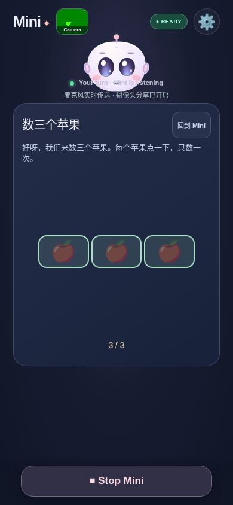
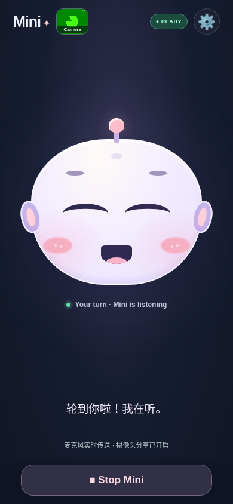
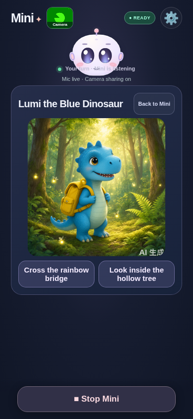
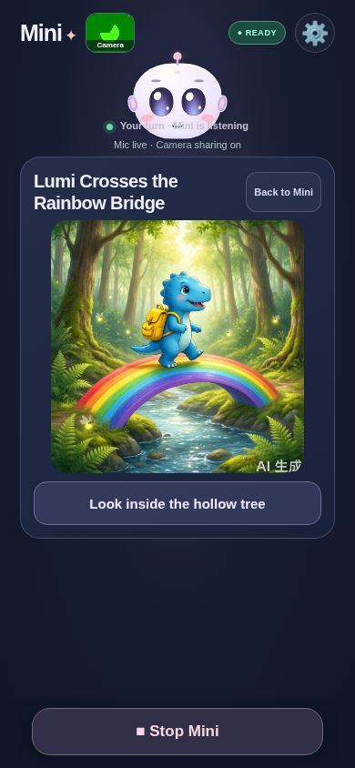

# Child-style companion review — 2 November 2026

The protected live app was exercised through a 23-checkpoint play-through, following a child's requests, short answers, picture choices, game moves, interruptions and goodbye. **The initial run passed 22 checkpoints and failed one.** Inspecting the actual story response exposed a second narration defect. Both defects are fixed in the repository and verified locally; the user's Windows deployment needs `git pull`, a server restart and a Safari refresh to receive them.

## What was real and what was simulated

- Real: authenticated HTTPS deployment, one valid SDP exchange/session grant, **five `qwen-plus` planning requests and two `qwen-image-3.0` images**, actual pointer clicks, browser image decoding, and synthetic microphone/camera capture and teardown. The grant was revoked successfully.
- Simulated: speech-recognition events, Qwen voice replies and the connected transport adapter. Eleven other planner responses were local test doubles. Riddle answers and reassuring replies were supplied by the harness; they do not establish the voice model's answer quality.
- Chromium 154 used a 390×844 mobile viewport. The same cloud browser still gathered **zero ICE candidates**, even after obtaining synthetic microphone and camera tracks. This review did not establish an audible WebRTC conversation, working Qwen speech recognition or physical iPhone Safari behavior. No private child recording was used.
- The live budget was one signaling session and two pictures. It was not repeated for fixes: all subsequent verification used local providers and captured synthetic plans. These figures describe this review only, separately from the preceding [single-plan/single-image check](LIVE_REVIEW_2026-11-02.md).

The live source was the previously published `f257153` baseline. The [original sanitized observations](child-review-results-2026-11-02.json) retain the original failure; the [local replay receipt](child-replay-results-2026-11-02.json) records the fixed behavior separately. Neither contains authentication headers, grants, SDP or private media. A duplicate cleanup revocation returned 401 after the first successful revocation; this was not a failed Stop.

## Findings and fixes

### 1. A child could remain stuck in counting after asking to chat

After tapping three apples, the child said **“我不想数了，我们聊聊天吧。”** (“I don't want to count anymore; let's chat.”). The real planner returned `keep` with a friendly chat message. The counting scene remained visible and the client retained its game narration/audio handling. The harness needed Back to Mini before continuing.

Explicit English/Mandarin chat requests now leave counting, hand games and tic-tac-toe locally. They clear the game checkpoint and pending narration, preserve the existing capture, and restore ordinary voice handling. No planner request or extra `response.create` is needed. Interrupted old audio stays muted; the new turn can play even if `response.created` arrives before the completed child transcript. One-word game answers, negated chat requests and tested quoted story lines do not trigger this exit.

| Original live counting scene | Fixed local chat exit |
| --- | --- |
|  |  |

### 2. A story choice could change the picture without supplying narration

The real story and continuation plans both contained `message: ""`. The selected bridge scene rendered successfully, but the continuation narration path received no text. This is a code-backed narration defect, not an observation of actual iPhone speaker output.

The renderer now falls back to the displayed scene title when a message is absent. The captured continuation therefore supplies **“Lumi Crosses the Rainbow Bridge”** to local speech synthesis. The planner instructions also require one or two short narration sentences for button continuations. The fallback guarantees useful text for this captured response; it does not invent a longer story or prove Safari audio playback. A supplied message still takes precedence.

## Child play-through observations

“Pass” below means the stated browser expectation passed under the real/simulated boundary above. Checkpoint 8 originally asserted the picture and continuation, not audible narration; the empty-message defect was found afterward.

| # | Child action or situation | Original result |
| --- | --- | --- |
| 1 | Obtain one authorized live session/visual grant | Pass: HTTP 200, valid SDP answer and grant |
| 2 | Grown-up starts a five-minute visit with camera/pictures on | Pass: one synthetic audio and video track |
| 3 | “Hi Mini”, then a one-word “cat” answer | Pass: client accepts the short turn |
| 4 | Animal riddle; “I don't know”, then “giraffe” | Pass: client accepts uncertainty and short answers; replies scripted |
| 5 | “Don't stop Mini” | Pass: capture continues |
| 6 | Interrupt an answer | Pass: old playback is suppressed; microphone stays enabled |
| 7 | Ask for Lumi, a blue dinosaur with a yellow backpack, a forest and two choices | Pass: real planner, decoded 1024-pixel image and two choices |
| 8 | Tap “Cross the rainbow bridge” | Pass for image: real continuation picture; empty narration discovered separately |
| 9 | Back to Mini | Pass: same microphone/camera, no reacquisition |
| 10 | Ask to use Mandarin | Pass: local language routing changes |
| 11 | Request and tap three apples | Pass: real count plan; exactly three objects; result `3 / 3` |
| 12 | Ask in Mandarin to leave counting and chat | **Fail: counting remains after real planner `keep`; fixed locally** |
| 13 | Say one learned English word during Mandarin conversation | Pass: Mandarin retained; Back to Mini was used after checkpoint 12 |
| 14 | Explicitly request English | Pass: local language routing changes |
| 15 | Request one round of rock-paper-scissors and choose a move | Pass: real plan; local winner/score match rules |
| 16 | Ask for tic-tac-toe and tap a square | Pass: one legal X/O pair; no extra planner request |
| 17 | Request an occupied or ambiguous square | Pass: board unchanged; clear local hint |
| 18 | Tap New round while a move is pending | Pass: no delayed ghost marks |
| 19 | “Can we just talk?” from the board | Pass: exit preserves capture |
| 20 | Grown-up mutes/unmutes and pauses/resumes camera | Pass: original capture retained; sender transport simulated |
| 21 | Start a new turn while scene planning is deliberately held | Pass: old request cancelled; no extra live call |
| 22 | “Bye Mini” | Pass: all capture tracks ended, displayed conversation cleared, grant revoked |
| 23 | Wait after goodbye | Pass: no automatic paid reconnect or grant stored in local storage |

The real images retained Lumi's blue body, yellow backpack and forest; the second image added the selected rainbow bridge. The screenshots show a similar character, not pixel-identical character identity. The initial picture checkpoint took about 9.1 seconds and the continuation about 9.5 seconds, including planning, generation and browser work. These two observations are not a latency benchmark.

| First real picture | Real picture after choosing the bridge |
| --- | --- |
|  |  |

## Verification after the fixes

- `npm test`: **201 passed, 0 failed**, including chat-intent cases, exits from all three games, response/transcript ordering and the empty-message title fallback.
- `node scripts/child-journey-browser.mjs`: **9/9 passed**, using the captured synthetic plans in `tests/fixtures/child-journey-plans.json`, decoded fixture images, scripted speech synthesis and real synthetic media. Verified the displayed-title narration reaches speech synthesis, Mandarin count exit makes no planner request, the next voice reply is unmuted, hand-game scoring, board exit and goodbye cleanup.
- Existing parent-settings and companion-close browser suites passed again. They cover enabled defaults, confirmation/cancellation, safe preference storage, responsive camera/Stop controls, same-track capture after closing a picture, image cancellation and Stop cleanup.
- The existing exploratory browser review also passed **9/9** scenarios, including permission retry, backgrounding and session-expiry simulations. These events were injected; a physical background/expiry visit remains separate.
- No additional paid model requests were made for any fix verification. The full landmark-inference suite passed in the earlier review; it was not rerun for these conversation-transition changes.

To reproduce the local replay, start the fixture and fresh synthetic-media Chromium exactly as described in [companion-benchmark.md](companion-benchmark.md), then run `node scripts/child-journey-browser.mjs`. It uses loopback only, has no live URL option and needs no private `.env`. Results and a screenshot are written under `/tmp`.

## Remaining physical-device checks

Use a supervised iPhone Safari visit to verify actual hearing/replies, opening and story-choice audio, interruptions, permission recovery, camera landmarks, device capture indicators, backgrounding and a full session-duration expiry. Ask the same Mandarin counting-to-chat question after updating Windows. Educational correctness, emotional appropriateness and camera descriptions must be assessed from real model replies; this scripted voice review cannot establish them.

This is a broad functional play-through with explicit limits. It does not establish reliability across children, devices, all model responses or extended unsupervised use.
