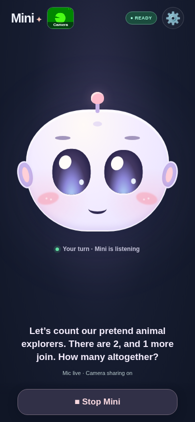
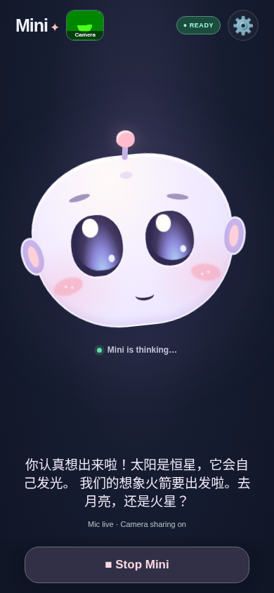

# Proactive bilingual play and learning — 2 November 2026

The user reported weak camera reactions, weak conversation initiative and too little maths/science teaching. They confirmed that iPhone Troubleshooting already showed **“Local reactions on · face in view”**. Tracking was reaching the device; this change improves what Mini does with those cues and adds checked learning turns beyond model instructions.

## What changed

| Area | Previous limitation | Current behavior |
| --- | --- | --- |
| Camera | Spoken reactions were limited to two arrival hellos. A cue seen during a reply could disappear before speech became eligible. | Smiles, winks and head movement have visible reactions and optional short spoken play invitations. A fresh cue can wait for quiet. Held smiles have a persistent visible response. |
| Initiative | Ordinary chat fallback was disabled and contextual questions often depended on the visual planner. | Topic-aware animal, space, garden and robot invitations work with Pictures off and without planner access. |
| Quiet pauses | A question could leave Mini waiting indefinitely. | One gentle check-in or lesson hint may follow a 14-second pause; silence never counts as a wrong answer and never creates a prompting loop. |
| Teaching | Maths/science mostly depended on Qwen following general instructions. | A session-only checked lesson loop teaches a small fact, asks one question, checks a short answer, gives a hint, then explains and returns to play. |
| Continuity | Qwen had little context about locally spoken follow-ups. | Optional session checkpoints include the last local invitation and bounded lesson state, so a short answer has context. No extra `response.create` is sent. |

The existing minimum grown-up controls and enabled defaults remain. There is no new setting, API key, model selection or `.env` change. Start confirmation, capture limits, Stop and background teardown remain in place. Pull the update on Windows, restart `npm start` and refresh Safari.

## Camera reactions

Local MediaPipe geometry still estimates visible smiles, one-eye winks, face position and head movement. Mini's eyes/head follow more clearly, and a held smile changes the eyes/cheeks while listening. It does not infer feelings or identity. This face tracker does not detect hand waves or full-body actions.

Fresh cues can wait up to 15 seconds for a quiet opportunity instead of being lost during Mini's reply. Speech waits for at least six quiet seconds, has a 20-second cooldown and allows at most eight camera invitations per session. The app also prevents closely spaced camera/conversation prompts. Continuous visual tracking has no eight-cue exhaustion limit.

Camera speech waits during child/AI speech, local narration, visual planning, a local game, an active learning question, the parent sheet, mute or backgrounding. A child asking for quiet, declining or expressing distress gets no new spoken invitation. Visible tracking can continue while voice is busy.

Example invitations describe an observation and propose play:

| Cue | English example | Mandarin example |
| --- | --- | --- |
| Smile | “I spotted a smile! Here is my robot smile. Shall our pretend robot hop or roll?” | “我看到一个微笑啦！我也露个机器人微笑。我们故事里的机器人用跳的，还是用滚的？” |
| Head movement | “I noticed your head move. My robot eyes are following! Shall we imagine something that rolls or flies?” | “我注意到你的头动了一下，机器人的眼睛跟着看啦！我们想象一个会滚的东西，还是会飞的东西？” |

These are locally spoken through the device's speech synthesis. Their voice can differ from Qwen's. The ordinary authorized realtime camera/voice feed continues independently; the reaction itself adds no cloud-vision request.

## Conversation and learning

After a substantive statement without a question, Mini can offer one relevant invitation after six seconds. If an existing question goes unanswered, one check-in can follow after 14 seconds. There are at most 24 scheduled conversation/quiet invitations per session and one per child turn. Child speech, touch, mute, a topic/activity change or Stop cancels pending prompts. Complete story endings, goodbye, explicit declines and distress suppress invitations.

Checked learning can begin after two engaged child turns and is spaced at least three child turns apart. It alternates maths and science, uses the current broad interest when possible and leaves ordinary play between questions. Explicit requests such as **“Teach me maths”**, **“Ask me a science question”**, **“教我数学”** and **“我想学科学”** start immediately.

| Local mini-lessons | Examples |
| --- | --- |
| Small addition/counting | Two pretend animal explorers and one more: how many altogether? |
| Subtraction within ten | Three explorers, one goes home: how many remain? |
| Shapes | How many straight sides does a triangle have? |
| Plants | Plants use light to make food; choose a sunny window or a dark cupboard. |
| Space | The Sun is a star and makes its own light. |
| Animals | Butterflies are insects; insects have six legs. |
| Motion | Predict whether a ball or cube rolls more easily; distinguish prediction from an experiment. |
| Materials | Ice is frozen water; warming can melt it. |

The local bank is intentionally small; Qwen remains responsible for broader child-led conversation and teaching. Its instructions now explicitly lead with a small discovery within the first few turns, alternate maths/science across play and use specific encouragement. Neither the checked bank nor prompt changes establish a complete curriculum.

The local loop accepts English/Mandarin number words, digits and supported choice answers. One uncertain/incorrect answer gets a concrete hint. A second gets a kind explanation and a playful next idea. Two successful maths checks can gradually raise the later arithmetic difficulty, staying within ten; a science mistake does not lower maths readiness. No grades or comparisons are shown. A language switch restates the same challenge without marking an error. Skipping, changing topic or expressing distress ends that question without a failure label.

During a checked turn, local feedback is the source for both displayed and spoken results. A contradictory automatic Qwen response stays muted and cannot overwrite it when `response.done` arrives. Ordinary voice handling returns when the child moves on. Session updates may still affect context/token usage; the app adds no separate paid planner/image call or extra generated voice turn for a local invitation or checked answer. Normal realtime-session/provider usage continues.

Only bounded catalog topic/progress/pending-question data is kept by the lesson helper. The app's existing transient captions remain session-only. Stop clears learning and local invitation context; no child learning profile, transcript history or recording is persisted.

## Verification

- `npm test`: **223 passed, 0 failed**. New cases cover checked bilingual answers, hints and explanations, arithmetic progression, correct science facts, topic/language changes, quiet pauses, cancellation, distress/declines, camera cooldowns and local prompt context. The frontend-serving test now checks every referenced script/stylesheet, including the new learning module.
- `node scripts/proactive-companion-browser.mjs`: **13/13 passed** with actual synthetic microphone/camera capture, scripted ASR/Qwen voice and landmark output, mocked device speech synthesis and real six-/14-second waits. No provider planning/image calls were made. See [the sanitized receipt](proactive-results-2026-11-02.json).
- Earlier child-journey replay: **9/9 passed again**, covering story continuation, counting, hand games, bilingual game exits and goodbye cleanup.
- Parent-settings, picture-close/media-cleanup and exploratory browser suites passed again. The exploratory suite passed **9/9**, including permission retry, backgrounding and deadline simulations.
- The full companion browser smoke suite also **passed**, including real local MediaPipe inference on the documented public-domain adult fixture, model metadata, four layouts, image decoding/failure suppression, face reactions during audio, Stop teardown and no external requests/JavaScript exceptions.

| English local maths invitation | Mandarin checked science feedback |
| --- | --- |
|  |  |

Additional evidence: [visible smile reaction](images/proactive-smile-2026-11-02.png) and [Mandarin checked maths answer](images/proactive-mandarin-answer-2026-11-02.png). Screenshots use synthetic media and scripted events, not a child's recording.

## Device check after updating

The user's face-detection status is confirmed, but the updated experience has not been heard or exercised on their physical iPhone. In a supervised five-minute Safari visit:

1. With Camera on, smile or gently move your head while Mini replies; check visible reaction first, then an occasional invitation after quiet.
2. With Pictures off, say “cat” and continue briefly. Check a relevant play invitation/discovery rather than repeatedly asking the child to choose the whole activity.
3. Say “Teach me maths”; answer incorrectly, then switch to Mandarin and answer the same question. Try “我想学科学”. Check the hint, accurate explanation and natural language.
4. Say “跳过”, ask for a story, ask for quiet and finally say goodbye. Confirm no pressure/repeated prompts and that microphone/camera indicators clear on Stop.

This local review verifies code, state, timing and rendering. It does not establish physical Safari audio playback, Qwen ASR/voice transport, child recognition accuracy or broad educational effectiveness. The earlier cloud ICE limitation still applies; no new paid live-model calls were made for this change.
